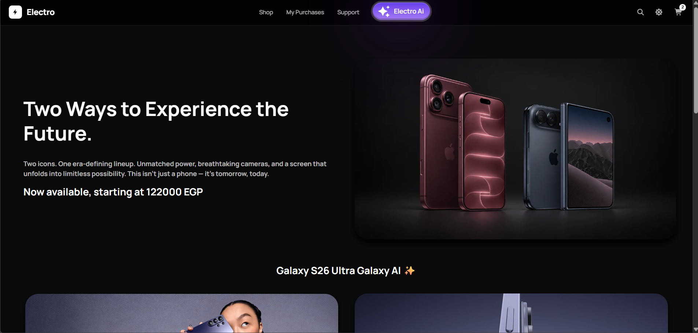
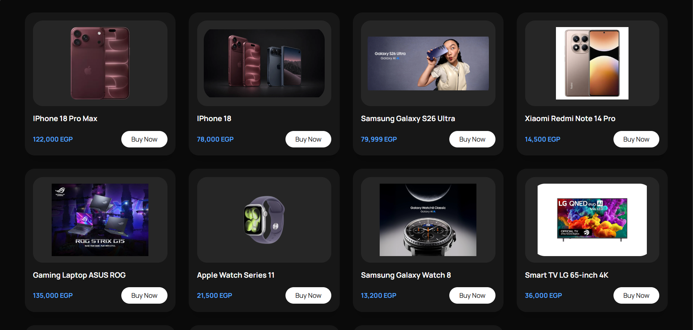
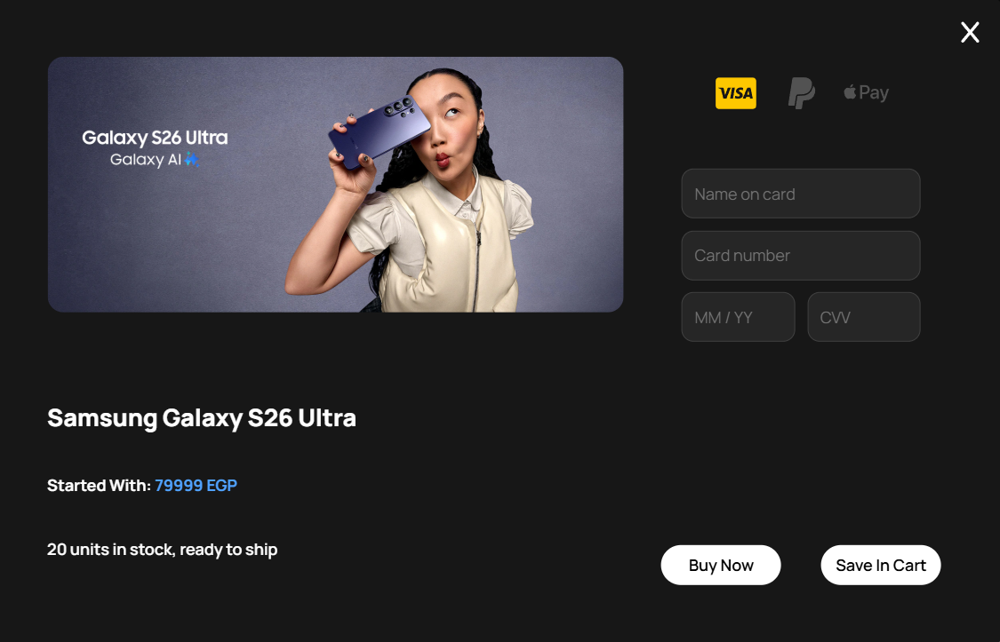
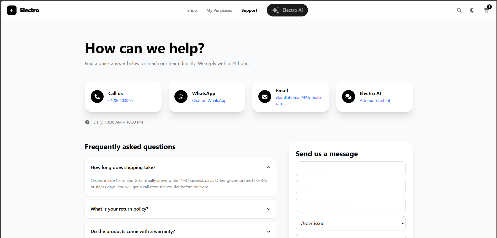
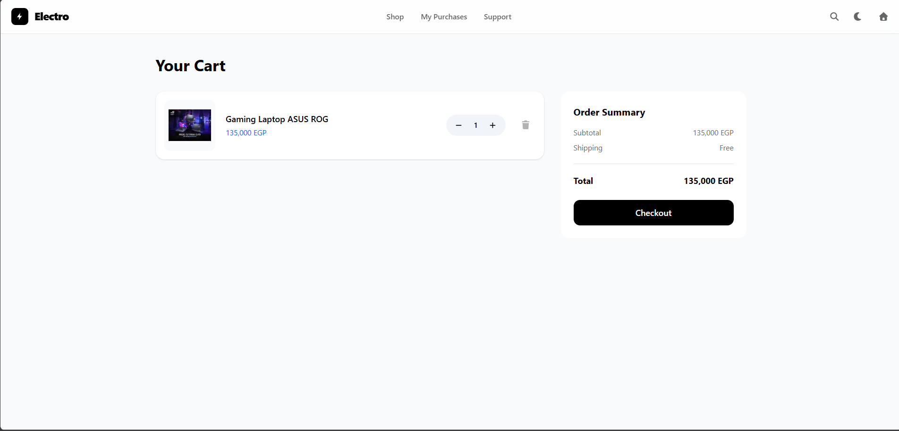
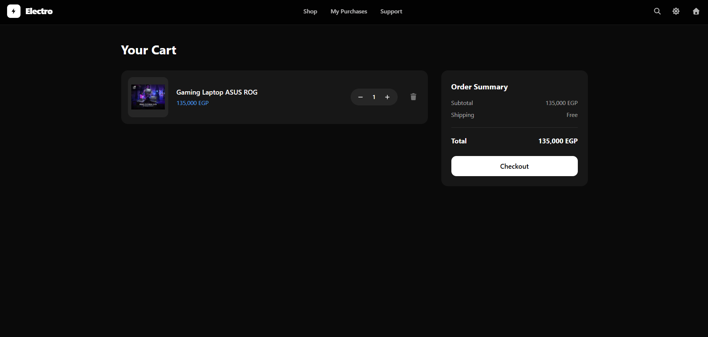
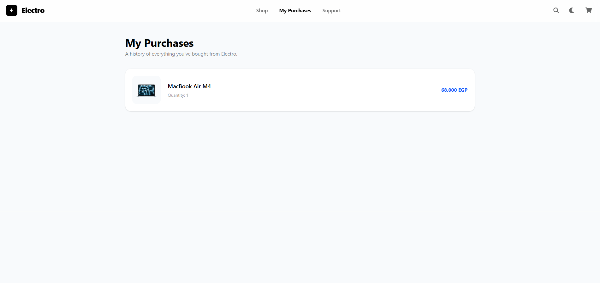
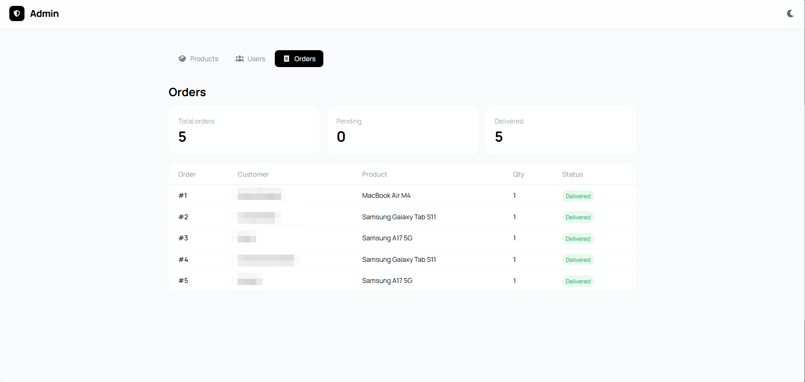
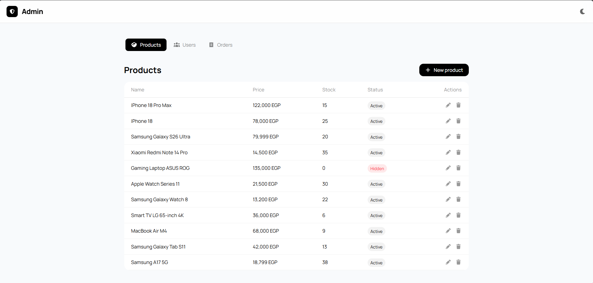
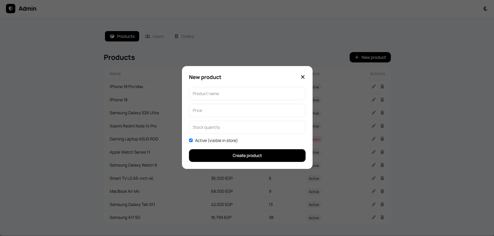

# ⚡ Electro: Frontend


The storefront for **Electro**, a full-stack electronics store, built with **Next.js (App Router)**, **TypeScript** and **Tailwind CSS**. It is responsive, supports light and dark themes on every page, and has a built-in AI assistant you can ask when you can't decide what to buy.

**Live:** [electro-frontend-khaki.vercel.app](https://electro-frontend-khaki.vercel.app/login) · **Backend repository:** [Electro-Backend](https://github.com/Omar404X0/Electro-Backend) · **API docs:** [Swagger](https://electro-backend-2dx5.onrender.com/docs)

---

## Live Pages

| Page | URL |
|---|---|
| Log in / Sign up | [/login](https://electro-frontend-khaki.vercel.app/login) |
| Store | [/prodacts](https://electro-frontend-khaki.vercel.app/prodacts) |
| Cart | [/cart](https://electro-frontend-khaki.vercel.app/cart) |
| My Purchases | [/purchases](https://electro-frontend-khaki.vercel.app/purchases) |
| Support | [/support](https://electro-frontend-khaki.vercel.app/support) |
| Admin dashboard (admins only) | [/admin](https://electro-frontend-khaki.vercel.app/admin) |

> The API runs on a free tier, so the first request after a period of inactivity can take up to a minute while it wakes up.

## Screenshots

### Storefront

| Home (dark) | Products (dark) |
|---|---|
|  |  |

| Buy modal | Support (with the Electro AI button) |
|---|---|
|  |  |

### Cart and purchases

| Cart (light) | Cart (dark) |
|---|---|
|  |  |

| My Purchases | Admin: Orders |
|---|---|
|  |  |

### Admin dashboard

| Products | New product |
|---|---|
|  |  |

## Highlights

- **🌗 Dark mode everywhere.** A theme toggle in every page header switches the whole interface between light and dark, with smooth color transitions.
- **🤖 Built-in AI assistant.** The **Electro AI** button in the header opens a chat connected to the store's real catalog. Ask it for a recommendation, a price comparison, or what's in stock. It answers only from products the store actually sells.
- **🛡️ Oversell-safe checkout.** Buying the last unit is protected against race conditions. If two customers click **Buy** at the same moment, only one purchase succeeds and the other is told the item is gone (see [Stock safety](#stock-safety)).
- **🔍 Instant search.** Multi-word matching with highlighted results. Open it with `Ctrl/⌘ + K`, close it with `Esc`. While searching, the hero sections collapse so the results are the first thing you see.
- **🛒 Personal cart.** Each user sees and edits only their own cart.
- **🧰 Admin dashboard.** Admins create, edit and delete products, manage users and roles, and review every order with its status. Non-admins see an access-denied screen.
- **📱 Responsive.** The buy modal is full-screen on phones and a centered dialog on larger screens. Animations respect `prefers-reduced-motion`.

## Tech Stack

| Purpose | Technology |
|---|---|
| Framework | Next.js (App Router), React |
| Language | TypeScript |
| Styling | Tailwind CSS |
| Icons | Font Awesome |
| Hosting | Vercel |

## Project Structure

```
.
├── app/
│   ├── login/         # log in and sign up
│   ├── prodacts/      # store home, search, buy modal
│   ├── cart/          # user cart
│   ├── purchases/     # purchase history
│   ├── support/       # support page
│   ├── admin/         # admin dashboard (products, users, orders)
│   ├── deels/         # deals page
│   ├── components/    # shared UI (AI assistant button and chat form)
│   ├── layout.tsx
│   └── globals.css
├── public/            # product images and media
├── docs/screenshots/  # images used in this README
├── .env.example
└── package.json
```

> Route names (`prodacts`, `deels`) are kept exactly as they appear in the code.

## Getting Started

**Requirements:** Node.js 20+ and a running copy of the [backend](https://github.com/Omar404X0/Electro-Backend).

```bash
git clone <this-repo-url>
cd <folder-name>
npm install
cp .env.example .env.local
npm run dev
```

Open [http://localhost:3000](http://localhost:3000).

| Script | What it does |
|---|---|
| `npm run dev` | Start the dev server |
| `npm run build` | Create a production build |
| `npm start` | Serve the production build |
| `npm run lint` | Run the linter |

## Environment Variables

| Variable | Description |
|---|---|
| `NEXT_PUBLIC_API_URL` | Base URL of the backend, with no trailing slash |

```
# local
NEXT_PUBLIC_API_URL=http://127.0.0.1:8000

# production
NEXT_PUBLIC_API_URL=https://electro-backend-2dx5.onrender.com
```

Variables prefixed with `NEXT_PUBLIC_` are baked into the bundle at build time, so restart the dev server (or redeploy) after changing one. Never put secrets in them: anything with that prefix is visible in the browser.

## How It Talks to the API

- After logging in, the JWT returned by the API is kept in `localStorage` under the key `token`.
- Requests that act on a user (cart, purchases, admin) send that token to the backend, which verifies it and decides who the user is. The frontend never sends a user id.
- The admin page asks the backend whether the token belongs to an admin and renders the dashboard only if it does. The real permission check happens on the server.
- The AI assistant calls the backend, which holds the Gemini key. The key never reaches the browser.

## Stock Safety

The frontend only displays stock ("Only 3 left in stock. Order soon."). The guarantee that stock can't be oversold lives in the backend: each purchase is a single atomic `UPDATE ... WHERE contity > 0`, so when two buyers race for the last unit, the database lets exactly one of them through. See [Concurrency and Stock Safety](https://github.com/Omar404X0/Electro-Backend#concurrency-and-stock-safety).

## Deployment (Vercel)

1. Import the repository on Vercel. The default root directory is correct.
2. Under **Project Settings → Environment Variables**, set `NEXT_PUBLIC_API_URL` to the deployed backend URL.
3. Deploy. Redeploy after any change to environment variables.
4. Add the Vercel origin (`https://electro-frontend-khaki.vercel.app`) to the backend's CORS `allow_origins` list.

## Troubleshooting

**`Failed to fetch`**
The backend is down or asleep, `NEXT_PUBLIC_API_URL` points to the wrong place, or the frontend's origin is missing from the backend's CORS list. A crash inside a backend route can also appear in the browser as a CORS error, so check the backend log.

**Hydration error mentioning nested `<html>` or `<body>`**
Only `app/layout.tsx` may render `<html>` and `<body>`. Delete any `layout.tsx` inside a route folder that repeats them (for example `app/cart/layout.tsx`).

**`x.reduce is not a function` or `x.map is not a function`**
A state value expected to be an array was `null` or an error object. Initialize list state as `[]` and check `Array.isArray(data)` before storing a response.

**Environment variable change has no effect**
Restart `npm run dev`, or redeploy on Vercel. `NEXT_PUBLIC_` values are fixed at build time.

## Roadmap

- [ ] Forgot password: emailed 6-digit code, verification, password reset
- [ ] Finish the Deals page
- [ ] Send the token in an `Authorization` header instead of the request body
- [ ] Component and end-to-end tests
